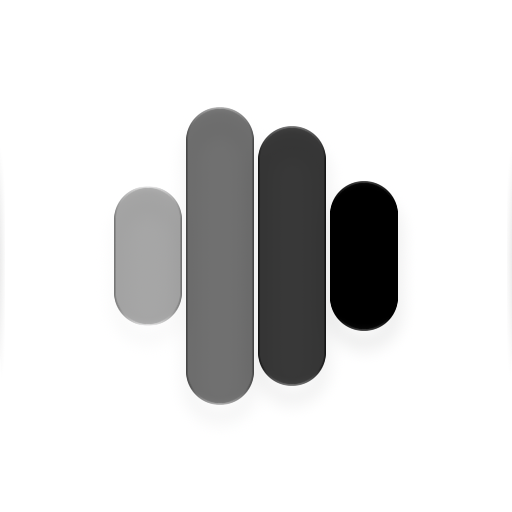
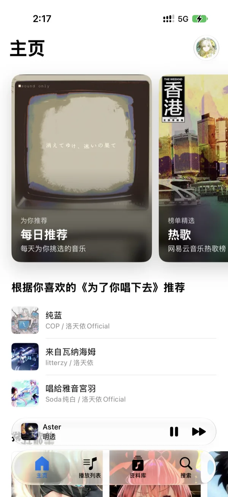
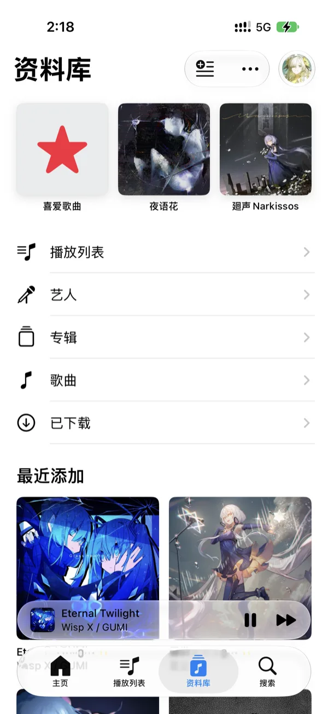
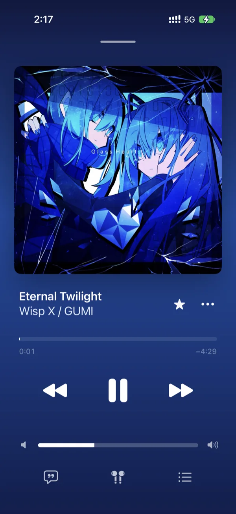
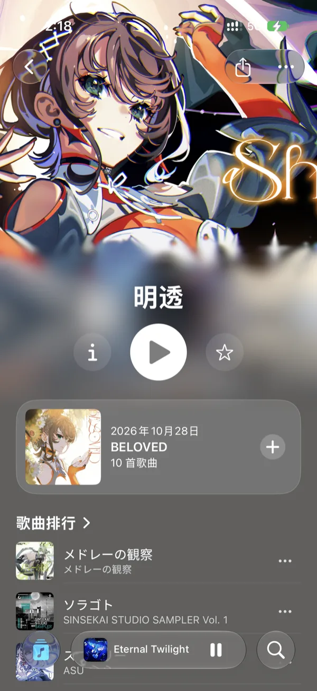

<div align="center">



# NeoMusic

**为 iPhone 打造的第三方网易云音乐客户端，支持本地音乐**

SwiftUI 与 UIKit 原生构建 · iOS 27 · AVFoundation 播放

[](#环境要求)
[](https://www.swift.org)
[](https://developer.apple.com/xcode/swiftui/)
[](LICENSE)

[功能亮点](#功能亮点) · [获取应用](#获取应用) · [从源码构建](#从源码构建) · [开发指南](docs/development.md) · [阶段计划](docs/roadmap.md)

</div>

<br>

## 应用截图

<table>
  <tr>
    <td align="center"><br><sub><b>主页</b></sub></td>
    <td align="center"><br><sub><b>资料库</b></sub></td>
    <td align="center"><br><sub><b>播放器</b></sub></td>
    <td align="center"><br><sub><b>艺人页</b></sub></td>
  </tr>
</table>

<p align="center"><sub>截图同时展示浅色与深色外观。</sub></p>

> [!IMPORTANT]
> NeoMusic 是个人开发的非官方第三方客户端，与网易云音乐及 Apple 均无关联，项目用于学习与交流，代码按 GPL v3.0 授权。项目正在开发中：网易云账户、歌单、搜索、下载与在线播放已接入、待体验验收，尚未发布正式版本。

## 为什么做 NeoMusic

[网易云音乐](https://music.163.com)是最常用的中文在线音乐服务之一，NeoMusic 是它在 iPhone 上的第三方客户端，同时管理手机里的本地音乐。界面与交互以 Apple 原生语义为基调——封面 zoom 转场、系统列表、侧滑与拖放重排都交给系统机制，而不是复刻某个跨平台设计。本地音乐不依赖登录；凭据保存在设备钥匙串，不运行服务器、不收集用户数据。

## 功能亮点

### 本地音乐

- **目录即资料库**：在「文件」App 中把音乐放进 NeoMusic 的音乐文件夹即自动扫描；每个直接包含歌曲的文件夹是一张专辑，子文件夹独立。支持 MP3、AAC/M4A、ALAC、FLAC、WAV、AIFF，内嵌封面优先，兼容同目录 `cover`／`folder` 图片
- **不依赖登录**：本地资料库、歌单与播放完全独立可用；退出或切换网易云账号不影响本地数据
- **播放列表**：创建、编辑、封面选择与文件夹整理；本地歌单可以引用在线歌曲
- **喜爱与置顶**：喜爱歌曲、置顶条目与最近添加，资料库内搜索

### 网易云

- **官网登录**：应用内官网登录，凭据保存在钥匙串；支持会话恢复、失效处理、切换账号与退出
- **首页推荐**：每日推荐、热歌、心动模式、私人雷达、私人漫游、相似歌曲六个快捷入口，加推荐歌单、排行榜、关注艺人新动向等栏目
- **歌单与统一喜爱**：账号歌单与收藏歌单、统一喜欢同步；歌曲左滑即可喜欢、下载或删除
- **搜索**：分类歌单、最近搜索、输入联想，以及歌曲／艺人／专辑／歌单分类结果
- **下载与离线播放**：单曲、专辑与整张歌单下载，默认无损音质；自动解码并写入标签、封面与歌词，下载文件退出账号后继续可用
- **音质**：标准／高品质／无损／Hi-Res，Wi-Fi 与蜂窝网络分开设置，播放中切换保留进度

### 播放

- **原生播放器**：迷你条随滚动收缩，全屏播放器展示封面、频谱与控件；队列拖动排序、循环与随机
- **歌词**：本地歌词读取与导入，在线逐行歌词及译文同步显示
- **续播**：队列、循环模式与暂停进度持久化，重启后恢复；在线歌曲优先播放已下载副本

### 个性化

- **标签栏自定义**：在账户页「标签页」可把喜爱歌曲、歌单、专辑、艺人、歌曲挂上底部标签栏，连同搜索最多 5 个，拖动调整顺序
- **账户一处可达**：主页与各标签右上角共用同一账户入口，未登录同样可以浏览

网易云在线能力（账户、歌单、搜索、下载、在线播放）均已接入，整体处于体验验收阶段；各阶段验证与验收状态见[阶段计划](docs/roadmap.md)。

## 环境要求

- iOS 27.0 或更高版本的 iPhone（暂不支持 iPad）
- 从源码构建：Xcode 27.1 或更新版本、Swift 6、[XcodeGen](https://github.com/yonaskolb/XcodeGen)
- 真机运行：可签名应用的 Apple ID 或开发者账号

## 获取应用

当前公开版本是 [v0.0.1](https://github.com/Fab1e2000/NeoMusic/releases/tag/v0.0.1)。没有 App Store 或 TestFlight 构建。

1. **自行签名安装**：在该 Release 下载未签名 IPA 与 `SHA256SUMS.txt`，核对校验值后，用自己的开发者证书或 SideStore、AltStore、Sideloadly 等工具签名安装。
2. **从源码构建**：见下一节，真机签名自行配置。

## 从源码构建

```sh
brew install xcodegen
xcodegen generate
open NeoMusic.xcodeproj
```

选择 `NeoMusic` scheme 和 iPhone 模拟器即可运行。参与开发前请阅读[项目规范](AGENTS.md)；`project.yml` 是工程配置的唯一编辑来源。最近验证环境、依赖版本与完整测试说明见[开发指南](docs/development.md)。

验证统一在本机执行，推送前通过 `pre-push` 钩子运行脚本回归、模块边界检查、工程生成和 Release 全量测试。安装与手动运行方式见[开发指南](docs/development.md)。推送匹配工程版本的标签会生成 Release 草稿，确认后手动发布。

## 项目结构

```text
NeoMusic/
  App/              # 启动、装配与标签栏
  Features/         # 主页、资料库、搜索、账户与播放器页面
  Core/             # 本地资料库、扫描、歌词、播放引擎与网易云业务
  Resources/        # 图标与来源声明
Packages/           # LNPopupUI、LNPopupController、AudioTags（TagLib 封装）
NeoMusicTests/                # 单元与业务回归测试
NeoMusicNavigationUITests/    # 原生交互测试
NeoMusicFunctionalParityTests/ # 专项对照测试
docs/               # 开发指南、阶段计划与发布说明
scripts/            # 本机检查、推送门禁与发布脚本
```

## 文档

| 文档 | 内容 |
| --- | --- |
| [开发指南](docs/development.md) | 环境、依赖、构建、测试与账户预览方法 |
| [阶段计划](docs/roadmap.md) | 各阶段目标、验证与验收状态 |
| [发布说明](docs/releases) | 每个版本的变化 |
| [项目规范](AGENTS.md) | 仓库规则、职责边界与验证要求 |

## 已知限制

- 网易云接口为非官方能力，服务端变更可能导致功能失效；音质与部分内容受账号、版权与地区限制。
- 在线能力整体仍在体验验收中；模拟器与单元测试通过不替代真机、真实账号的体验验收。
- 专辑取色使用私有 `MPArtworkColorAnalyzer`，LN 播放器容器也使用私有 UIKit 接口；系统升级兼容性与 App Store 分发需专项评估。
- 面向 iPhone；iPad 适配与 macOS 开发未开始。
- 项目不承担旧项目数据、账号或偏好迁移。

## 免责声明

- NeoMusic 是**非官方**第三方客户端，由个人独立开发，与网易云音乐、Apple 均无隶属、合作或授权关系；「网易云音乐」及相关标识归其权利人所有。
- 不托管、不再分发任何音乐内容；歌曲、封面与歌词由设备直接向网易云公开服务请求，版权归原权利人。
- 不提供绕过付费、会员或地区限制的能力；不运行服务器、不收集用户数据，登录凭据保存在设备钥匙串。
- 代码的使用、修改与分发遵循 GNU GPL v3.0；音乐内容、商标及网易云音乐服务的使用遵循各自权利与适用服务条款。
- 权利人如认为本项目侵犯权益，可通过 [Issues](https://github.com/Fab1e2000/NeoMusic/issues) 联系，会及时处理。

## 许可

NeoMusic 采用 [GNU GPL v3.0](LICENSE)。播放器前端从 NeoDizzy 适配，包含源自 MeloX / MeloX_Modified 的 GPL-3.0 代码；LNPopupUI、LNPopupController、Nuke、TagLib 等依赖保留各自的版权与许可声明：

- [播放器来源声明](NeoMusic/Features/Player/Resources/PlayerSourceNotices.txt)与[导入清单](NeoMusic/Features/Player/Resources/PlayerSourceManifest.json)
- [网易云账户协议与认证来源声明](NeoMusic/Resources/NeteaseSourceNotices.txt)
- [GPL-3.0 全文](NeoMusic/Features/Player/Resources/GPL-3.0.txt)、[第三方声明](NeoMusic/Features/Player/ThirdPartyLicenses.txt)与[Nuke 许可](NeoMusic/Features/Player/Resources/Nuke-LICENSE.txt)
- [LNPopupUI 改动说明](Packages/LNPopupUI/NEOMUSIC-PATCHES.md)与[LNPopupController 改动说明](Packages/LNPopupController/NEOMUSIC-PATCHES.md)

## 致谢

- [youshen2/MeloX](https://github.com/youshen2/MeloX)：原生 SwiftUI 第三方网易云音乐客户端，播放器前端与网易云接口的参照
- [LeoNatan/LNPopupUI](https://github.com/LeoNatan/LNPopupUI) 与 [LNPopupController](https://github.com/LeoNatan/LNPopupController)：播放器容器
- [kean/Nuke](https://github.com/kean/Nuke)：图片加载与缓存
- [TagLib](https://taglib.org)：音频标签读写（LGPL／MPL，经 `Packages/AudioTags` 封装）
- NeoDizzy：播放器前端的适配基线

以上项目保留各自许可。
