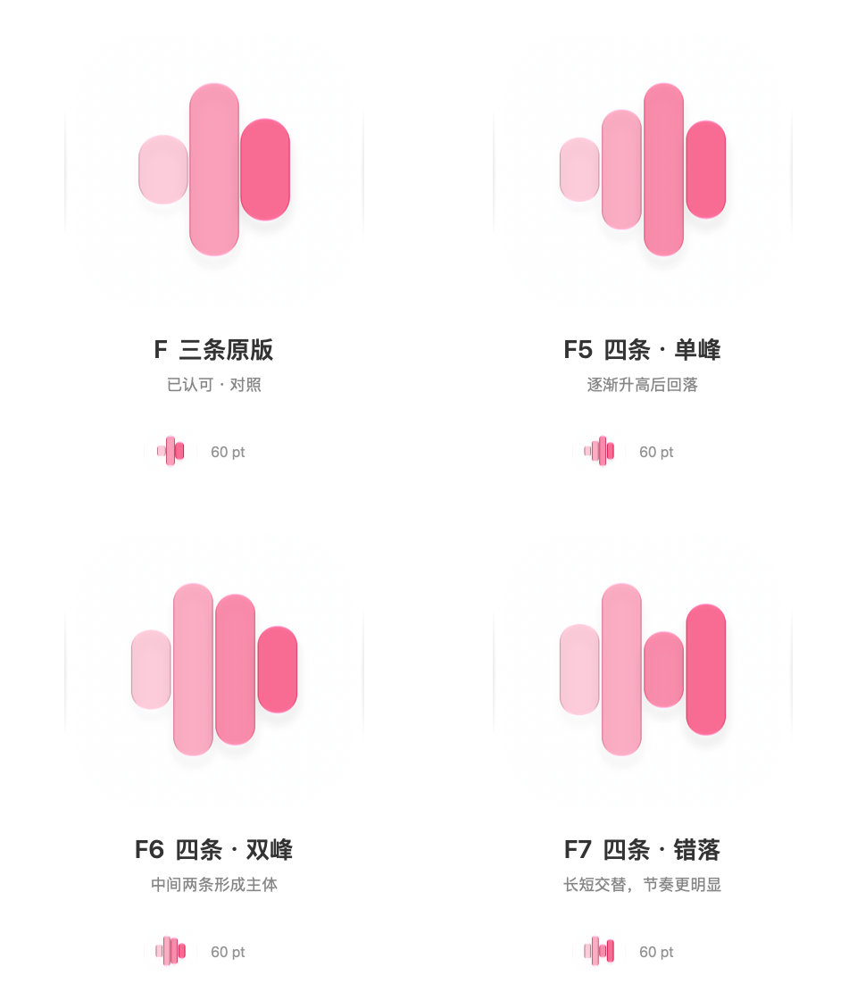
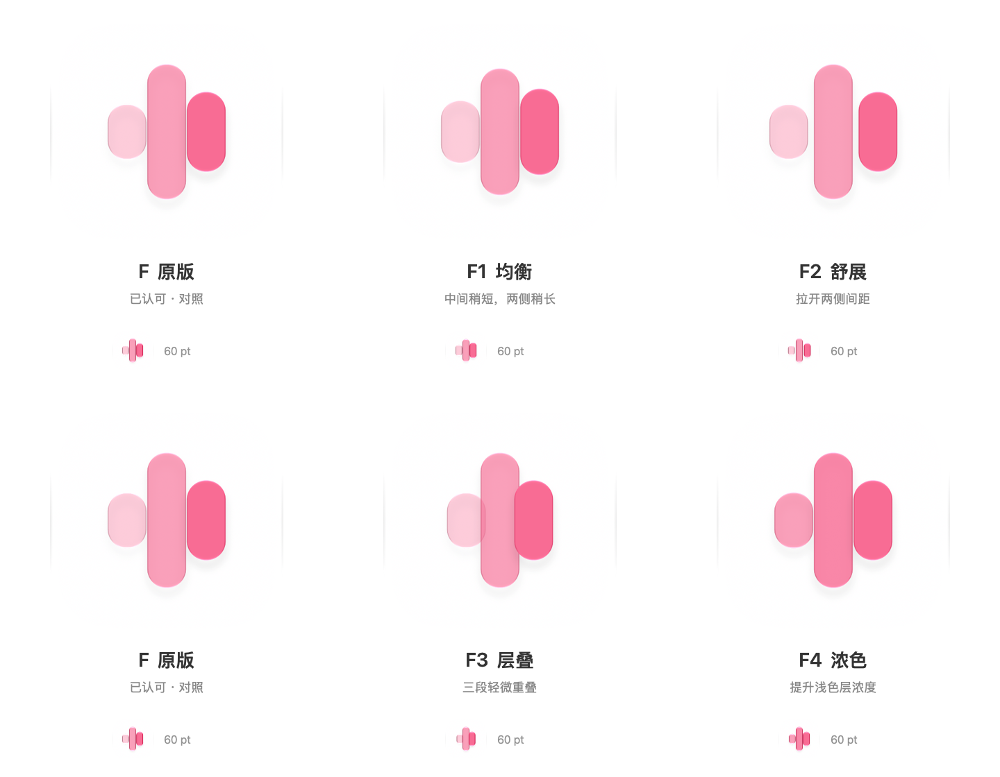
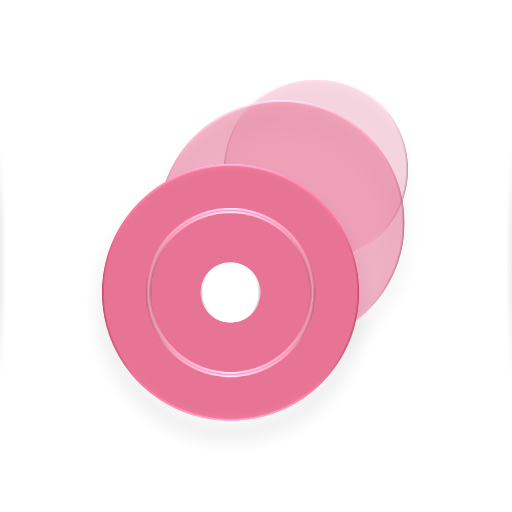
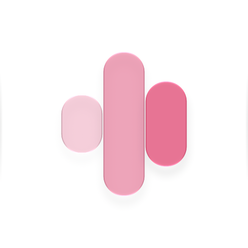

# NeoMusic 图标样稿

各方案均为白底、原创 SVG 图层与 Icon Composer 原生材质。用户已确认 F6 黑色方案；正式源位于 [NeoMusicIcon.icon](../../NeoMusic/Resources/AppIcons/NeoMusicIcon.icon)，已接入应用 target。本目录保留设计参考，不打包到应用。

## 当前方案：F6 黑色

用户确认 F6 可行，并要求主色改为黑色。四个 SVG 图层的填充改为 `#000000`，保留 F6 的柱高、宽度、间距、35%／56%／78%／100% 不透明度、白色背景及原生材质；从左至右形成浅灰至黑的层次。原莓红版保留对照。


[打开历史 F6-Black.icon](f-variants/F6-Black.icon)。1024px／512px／60pt 默认外观导出通过，图层检查确认仅修改填充色。黑色方案已获确认，接入后的实际应用图标随本轮重包装验收；后续正式编辑以应用内的图标源为准。

正式图标另加入用户已确认的深色反白与系统着色配置，避免黑色图层在深色背景中失去对比度。默认外观导出与原 F6 黑色文件逐字节一致；各外观沿用原形状与不透明度。本目录的历史源文件保持原样。

## F 差分（已选 F6，保留对照）

2026-11-02 用户认可 F，要求在其基础上做差分。原版 F 源文件保持不变，以下历史比较稿使用白底、莓红 `#F76C94` 与圆头声波，原生玻璃与阴影配置沿用原版。首轮只调整三条的参数，用户随后提出增加一条，补充以下四条版本。

### 四条版本（已选 F6）



| 方案 | 从左至右的柱高（1024px 画布） | Icon Composer 文件 |
| --- | --- | --- |
| F5 · 单峰 | 228／416／596／338 | [F5-SinglePeak.icon](f-variants/F5-SinglePeak.icon) |
| F6 · 双峰 | 280／596／520／300 | [F6-TwinPeak.icon](f-variants/F6-TwinPeak.icon) |
| F7 · 错落 | 320／596／264／452 | [F7-Offbeat.icon](f-variants/F7-Offbeat.icon) |

三款均为四个独立的原生材质组；柱宽 136px、间距 8px，左至右不透明度 35%／56%／78%／100%，各柱保持垂直居中。512px 和 60pt 原生导出及图层引用检查通过；用户认可 F6 造型，颜色改稿见上方。

### 三条差分（保留比较）



| 方案 | 相对原版的变化（1024px 画布） | Icon Composer 文件 |
| --- | --- | --- |
| F1 · 均衡 | 左／中／右高度由 246／596／352 改为 280／560／380，保持垂直居中 | [F1-Balanced.icon](f-variants/F1-Balanced.icon) |
| F2 · 舒展 | 柱间间距由 4px 增至 26px | [F2-Spaced.icon](f-variants/F2-Spaced.icon) |
| F3 · 层叠 | 两侧向内移动，柱间由 4px 间距改为 22px 重叠，前后顺序保持不变 | [F3-Layered.icon](f-variants/F3-Layered.icon) |
| F4 · 浓色 | 左／中／右不透明度由 35%／65%／100% 改为 65%／82%／100%，几何不变 | [F4-Bolder.icon](f-variants/F4-Bolder.icon) |

四款 `.icon` 与 SVG 引用检查通过，512px 和 60pt 默认外观均由 Icon Composer 导出并查看。对照图每行左侧均为原版 F。这些差分仅保留比较，未接入正式应用。

## 第二轮：单一主色、鲜明轮廓（已选 F）

用户未认可第一轮，并选择更接近 NeoBili 的单色与鲜明轮廓方向。第二轮统一使用莓红 `#F76C94`，以同色透明度和原生玻璃效果区分层次；保留白底，分别比较音符、唱片和声波造型。颜色仍可随选定造型调整。

| D · 连音 | E · 叠片 | F · 声脉 |
| --- | --- | --- |
|  |  |  |
| 两层连音轮廓，音乐含义直接。 | 三张同色唱片错位叠放，沿用系列层叠语言。 | 三段不同长度的圆头声波，轮廓最简洁。 |

可编辑文件：`round-2/D-Ligature.icon`、`round-2/E-Disc.icon`、`round-2/F-Pulse.icon`。大图和 60pt 小尺寸均由 Icon Composer 原生导出并检查；用户已认可 F 作为继续细化的基础。

## 第一轮（用户未认可，保留对照）

| A · 层叠音符 | B · 唱片封套 | C · N 节拍 |
| --- | --- | --- |
|  |  |  |
| 最接近系列的卡片语言，音乐含义直接。 | 薄荷唱片与紫色封套，强调本地唱片收藏。 | 珊瑚、金色、薄荷三层组成 N，强调 Neo 标识。 |

## 编辑与导出

直接用 Icon Composer 打开任一 `.icon` 文件。每个文件包都包含 `icon.json` 与可单独编辑的 `Assets/*.svg`。圆角蒙版、阴影和玻璃高光由 Icon Composer 生成，未画入 SVG；白色底由文档背景填充提供。

预览使用 Xcode 27.2 内附 Icon Composer 的 `ictool` 导出，示例（在仓库根目录运行）：

```sh
"/Applications/Xcode.app/Contents/Applications/Icon Composer.app/Contents/Executables/ictool" \
  design/app-icon-concepts/round-2/D-Ligature.icon --export-image \
  --output-file design/app-icon-concepts/round-2/D-Ligature.png \
  --platform iOS --rendition Default --width 512 --height 512 --scale 1 \
  --design-generation 27
```

本轮检查默认外观的大图与 60pt 小尺寸可读性；深色、清透、着色外观及真机动态材质随选定方案再验收。GUI 首次启动停在 Apple 许可协议，未代用户接受；本轮图片由自带命令行渲染器导出。

工作方式参考 Apple 的 [Create icons with Icon Composer](https://developer.apple.com/videos/play/wwdc2025/361/)：先制作独立矢量图层，再在 Composer 中定义背景、分组与材质。
