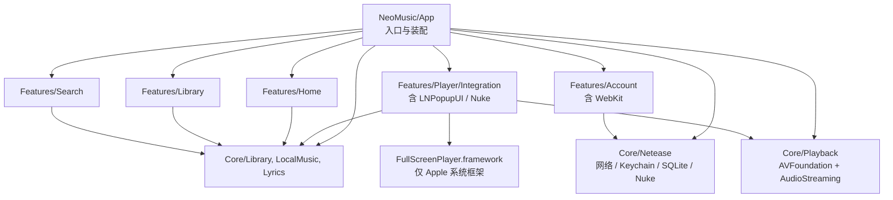

# NeoMusic 架构说明

本文档描述 NeoMusic 仓库的工程结构、模块职责、依赖边界、运行时装配关系与构建入口。

## 1. 工程与 Target 结构

工程配置源为根目录 `project.yml`，通过 XcodeGen 生成 `NeoMusic.xcodeproj`。

- 平台与语言：iOS 27.0+，Swift 6.0，iPhone（`TARGETED_DEVICE_FAMILY: "1"`）
- 主应用 Bundle ID：`com.elsterlee.NeoMusic`
- 后台模式：`UIBackgroundModes: [audio]`；开启 `UIFileSharingEnabled` 与 `LSSupportsOpeningDocumentsInPlace`

### Targets

| Target | 类型 | 源码路径 | 依赖 |
| --- | --- | --- | --- |
| `NeoMusic` | Application | `NeoMusic/`（排除 `Features/Player/FullScreenPlayer`） | `FullScreenPlayer`、`AudioStreaming`、`AudioTags` (`AudioTagBridge`)、`LNPopupUI` (`LNPopupUI-Static`)、`Nuke`、`NukeUI` |
| `FullScreenPlayer` | Framework | `NeoMusic/Features/Player/FullScreenPlayer` | 仅 Apple 系统框架 |
| `FullScreenPlayerTests` | Unit Test | `FullScreenPlayerTests/` | `FullScreenPlayer` |
| `NeoMusicTests` | Unit Test | `NeoMusicTests/` | `NeoMusic`、`FullScreenPlayer` |
| `NeoMusicNavigationUITests` | UI Test | `NeoMusicNavigationUITests/` | `NeoMusic` |
| `NeoMusicFunctionalParityTests` | UI Test | `NeoMusicFunctionalParityTests/` | `NeoMusic` |

### Schemes

| Scheme | 构建目标 | 测试目标 |
| --- | --- | --- |
| `NeoMusic` | `NeoMusic` | `NeoMusicTests`、`FullScreenPlayerTests`、`NeoMusicNavigationUITests` |
| `FullScreenPlayer` | `FullScreenPlayer` | `FullScreenPlayerTests` |
| `NeoMusicFunctionalParity` | `NeoMusic` | `NeoMusicFunctionalParityTests` |

### 依赖包

| 依赖 | 来源 / 版本 | 路径 |
| --- | --- | --- |
| `AudioStreaming` | 本地包 | `Packages/AudioStreaming` |
| `AudioTags`（TagLib 封装） | 本地包 | `Packages/AudioTags` |
| `LNPopupUI` | 本地包 | `Packages/LNPopupUI` |
| `LNPopupController` | 本地包 | `Packages/LNPopupController` |
| `Nuke` | SPM `13.2.0` | 远程包 |
| `LNSwiftUIUtils` | SPM `1.1.5` | 远程包 |
| `LNSystemMarqueeLabel` | SPM `0.1.2` | 远程包 |

---

## 2. 目录与模块职责

```text
NeoMusic/
├── App/                              # 入口、运行时容器、壳层导航与各领域装配
├── Core/
│   ├── Library/                      # 本地资料库、歌单/文件夹持久化、身份标识、封面缓存
│   ├── LocalMusic/                   # 本地目录扫描、音频元数据读取、下载文件标签写入
│   ├── Lyrics/                       # 歌词模型与解析读取
│   ├── Playback/                     # 播放引擎、音频图、频谱分析、队列与媒体会话
│   ├── Netease/                      # 网易云网络、凭据、账号、缓存、搜索与下载存储
│   └── PerformanceDiagnostics.swift  # AppLogger 与 os.signpost 性能打点
├── Features/
│   ├── Home/                         # 主页视图与内容模型
│   ├── Library/                      # 资料库、歌单/专辑/艺人详情、编辑器与共用组件
│   ├── Search/                       # 搜索页面
│   ├── Account/                      # 账户页面、音质设置与 WebKit 登录页
│   └── Player/
│       ├── FullScreenPlayer/         # 独立编译为 FullScreenPlayer.framework 的全屏播放器
│       ├── Integration/              # 宿主适配层（连接播放器模型、歌词、封面与 LNPopup）
│       ├── NowPlayingModel.swift     # 宿主播放状态与队列模型
│       ├── NowPlayingHistory.swift   # 播放历史与账号过滤
│       ├── NowPlayingContinuation.swift # 推荐续播与队列衔接
│       └── PlaybackQueuePersistence.swift
└── Resources/                        # App 图标、资产与来源声明
```

---

## 3. 模块依赖边界

源码依赖边界由 `scripts/check-module-boundaries.py` 静态扫描 `NeoMusic/` 下全部 `.swift`、`.m`、`.mm`、`.h`、`.metal` 文件执行约束：



核心隔离规则如下：

1. **网易云业务隔离**
   - `Netease*` 类型仅允许出现在 `Core/Netease`、`Features/Account` 与 `App`。
   - `URLSession`、`HTTPCookieStorage`、`SecItem*`、`CommonCrypto` 仅允许出现在 `Core/Netease`。
   - `URLRequest`、`HTTPCookie`、`WKWebView`、`WKWebsiteDataStore`、`WebPage`、`music.163.com`、`netease.session` 仅允许出现在 `Core/Netease` 与 `Features/Account`。
   - `Core/Netease` 不得引用 `LocalLibrary*`、`LocalMusic*`、`PlaylistLibrary`、`NowPlayingModel`、`ReferencePlayer*`、`PlayerState`、`PlayerPlaybackSource`、`PlayerServices`。
2. **`FullScreenPlayer.framework` 隔离**
   - 仅允许导入 Apple 系统框架（`SwiftUI`、`UIKit`、`Foundation`、`Observation`、`AVKit`、`AVFoundation`、`MediaPlayer`、`MetalKit`、`CoreImage`、`CoreGraphics`、`UniformTypeIdentifiers`，以及 `NowPlayingAirPlayButton.swift` 中的 `CoreBluetooth`）。
   - 不得引用宿主实现类型（`NowPlayingModel`、`LibrarySongItem`、`LyricsReader`、`LocalLibrary*`、`ArtworkImagePipeline` 等）、`Bundle.main`、`UIImage(named:)` 或账号格式前缀。
   - `.metal` 着色器仅允许位于 `Features/Player`。
3. **定向第三方框架导入**
   - `LNPopupUI`、`Nuke`、`NukeUI`、`MetalKit` 仅允许在 `Features/Player`（框架目录外）使用；`NeteaseArtworkCache.swift` 允许导入 `Nuke`。
   - `AudioStreaming` 仅允许在 `Core/Playback/StreamingPlaybackDeck.swift` 导入。
   - `AudioTagBridge` 仅允许在 `Core/LocalMusic/DownloadedAudioTags.swift` 导入。
   - `SQLite3` 仅允许在 `Core/Netease/NeteasePageCache.swift` 导入；`Network` 仅允许在 `Core/Netease/NeteaseMusicStore.swift` 导入；`ImageIO` 额外允许在 `Core/Netease/NeteaseAvatarSnapshot.swift` 导入。

---

## 4. 运行时装配与生命周期

### 启动与装配（`NeoMusic/App`）

- `NeoMusicApp`（`@main`）持有 `DownloadBackgroundDelegate`（UIKit 后台下载代理）与单一 `AppRuntime` 实例。
- `AppRuntime` 构造并持有：
  - `NeteaseAccount`（注入 `NeteaseAccountClient`、`NeteaseCredentialStore`、`NeteaseAvatarClient`）
  - `OnlineLibraryIntegration`、`HomeMusicIntegration`、`ArtistMusicIntegration`、`SearchMusicIntegration`、`DownloadMusicIntegration`
- 视图树通过 `LocalLibrary.app` 挂载，并经 SwiftUI `Environment` 向下注入 `account`、`libraryDownloads`、`homeMusicIntegration`、`artistMusicIntegration`、`searchMusicIntegration` 及 `artworkLoadAction`。
- `AppShell`、`LibraryAppTabs`、`LibraryDetailNavigation` 管理底部标签栏（`AppTab` 及其可排序配置）与各标签独立的导航实例（`AppTabNavigationRegistry`）。

### 启动阶段并发流（`AppRuntime.start()`）

1. 绑定各 Integration 回调（`downloads.connect()`、`search.connect()`、`home.connect()`、`artists.connect()`、`onlineLibrary.connect()`、`onlineLibrary.connectLyrics()`）。
2. 由单个启动任务并行管理本地和在线恢复。本地资料库恢复缓存并独立完成初始呈现。在线分支先恢复下载记录与元数据，再恢复缓存账号与在线资料库。
3. 当账号恢复身份与本地播放恢复均就绪时，调用 `completeRestoredPlayback()` 还原队列与暂停位置。
4. 并行执行后台刷新：
   - 本地目录扫描（`LocalLibrary.runtime.refresh()`）
   - 剩余在线内容加载与账号校验（`restoreRemainingOnlineContent()`）
   - 初始在线封面准备（`prepareInitialOnlineArtwork()`）

### 前后台切换（`AppRuntime.sceneDidChange`）

- 进入后台：持久化播放队列（`LocalLibrary.player.saveQueueForBackground()`）与歌单状态（`LocalLibrary.playlistLibrary.saveForBackground()`）。
- 返回前台：触发本地目录刷新（`LocalLibrary.runtime.refresh()`）与账号重验（`account.revalidate()`）。

### 封面路由（`AppRuntime.requestArtwork(for:)`）

按 `DeferredArtworkKey` 的 `domain`（`.music`、`.home` / `.homePlaylist`、`.artists`、`.search`）分发到对应 Integration 请求或查询缓存文件。\`DeferredArtworkRoute\` 校验会话和缓存返回结果，Online 与 Home 共用 16 ms 封面发布合批器。五个 Integration 共用引用曲目查找、喜爱反馈或曲目投影中的相应组件。

首页来源的播放队列封面由当前与下一曲、可见队列项及 UIKit 预取回调触发。`NeteaseHomeStore` 按会话管理请求，`NeteaseArtworkCache` 将前台需求提交为高优先级，并在写入新下载前验证图像可解码。

---

## 5. 核心子系统

### 本地资料库与扫描（`Core/Library`、`Core/LocalMusic`）

- `LocalLibrary` 与 `LocalLibraryRuntime` 管理本地曲目索引、专辑聚合、最近添加（`LibraryRecentAdditions`）、播放集合历史与歌单及文件夹（`PlaylistLibrary`）。
- `LocalMusicScanner` 扫描应用 Documents 下的音乐目录；`LocalAudioMetadataReader` 读取音频元数据与封面；`LocalArtworkImages` 负责封面派生与缓存；`DownloadedAudioTags` 通过 `AudioTagBridge`（TagLib）为下载音频写入标签。
- 资料库艺人由本机曲目、当前账号的喜爱歌曲与已载入的歌单曲目、收藏专辑及艺人订阅投影。`LibraryArtistPreferences` 保存本地艺人的 UUID、离线喜爱和按账号区分的艺人置顶，在线喜爱沿用账号的艺人订阅。`PinnedOrderStore` 保存艺人、专辑与播放列表的混合顺序。
- `LibraryRoute.libraryArtist` 打开资料库艺人详情，`LibraryRoute.artist` 打开在线艺人主页。已下载专辑可以从资料库艺人详情进入基于本机曲目的专辑页。本地专辑沿用目录分组和文件中的年份标签。
- 资料库艺人头像由列表、详情和置顶卡片按需读取。`NeteaseArtistStore` 按账号缓存头像元数据，复用订阅、艺人详情和图片缓存，并限制同时进行的资料库头像请求数。头像文件就绪后通过 Observation 更新对应视图。
- `AppStoragePaths` 声明音乐目录、应用状态与缓存路径。`AtomicJSONStore` 统一原子 JSON 读写，`AppDefaultsKey` 集中管理偏好键。封面取色共用 `Caches/ArtworkBackdrops.json`。
- `ImageSourceThumbnail` 负责封面、头像与选图的 ImageIO 缩略图解码。普通缩略图加载与详情页的背景取色分别触发。
- 全部歌曲、专辑、歌单与喜爱歌曲共用 `NativePlaylistTrackList`。按名称或艺人排序的全部歌曲使用 UIKit diffable data source 提供 Section 和原生索引。专辑与歌单的列表使用 `GenericCollectionList`，其网格与资料库艺人专辑共用 `LibraryCollectionGrid`。
- 歌单移到文件夹时，由 `LibraryToastCenter` 显示可打开目标文件夹的提示。

### 播放与音频管线（`Core/Playback`、`Features/Player`）

- `NowPlayingModel` 持有队列与播放状态，`PlaybackQueuePersistence` 负责队列持久化。播放队列与歌单各自通过 `BackgroundTaskPersistenceQueue` 串行写入，进入后台时使用 UIKit 后台任务完成待保存工作。
- 迷你播放器与全屏播放器的本地封面共用 `LocalArtworkImages`。宿主与全屏播放器编译同一份 `ArtworkColorSpace`，各自计算所需的调色板。
- `LocalPlaybackEngine` 协调音频播放，`PlaybackAudioActor` 与 `SharedAudioGraph` 管理音频图：
  - 本地文件由 `LocalFilePlaybackNode` 解码输出。
  - 在线音频流由 `StreamingPlaybackDeck`（基于 `AudioStreaming`）解码输出。
  - 实时频谱由 Objective-C 模块 `AudioSpectrumAnalyzer` 计算。
- `PlaybackMediaSession` 对接系统媒体会话与锁屏/控制中心命令。
- `Core/Lyrics`（`LyricsReader`、`LyricsDocument`、`LyricsPresentationModel`）负责本地与在线歌词的读取、解析与呈现模型。

### 网易云业务（`Core/Netease`）

- **账户与凭据**：`NeteaseAccount` 协调登录、恢复、重验与退出；`NeteaseCredentialStore` 读写 Keychain；`NeteaseAvatarClient` 与 `NeteaseAvatarSnapshot` 管理头像缓存与本地缩略快照。
- **在线数据与缓存**：`NeteaseMusicClient` / `NeteaseMusicStore`、`NeteaseHomeStore`、`NeteaseArtistClient` / `NeteaseArtistStore`、`NeteaseSearchClient` / `NeteaseSearchStore` 负责对应领域请求与状态；`NeteasePageCache` 使用 SQLite 按账号与键持久化页面缓存；`NeteaseArtworkCache` 通过 Nuke 管理在线封面缓存。
- 五个在线 Store 共用 \`NeteaseSessionScope\` 管理会话版本和任务取消。Music、Home、Artist 共用 \`KeyedPageCacheWriter\`，Music、Home、Artist、Search 共用 \`ScopedArtworkLoader\`。
- 首页页面缓存位于 `Caches/NeteaseHome/content.sqlite`。已保存的日推快照按账号保存在 `Application Support/NeteaseHome/DailyHistory`，供历史播放引用。
- **下载**：`NeteaseDownloadStore`、`NeteaseDownloadClient`、`NeteaseDownloadTransport` 与 `NeteaseDownloadedAudio` 管理后台下载任务、NCM 解码与本地落地文件。

---

## 6. 全屏播放器框架接口（`FullScreenPlayer`）

`FullScreenPlayer.framework` 的入口视图为：

```swift
FullScreenPlayerView(
    player: PlayerState,
    services: PlayerServices,
    initialPage: NowPlayingPage = .artwork,
    isActive: Bool = true,
    onDismiss: (() -> Void)? = nil,
    artworkTransition: ArtworkTransition // 默认为 EmptyModifier
)
```

全屏播放器的队列页使用同一个 UICollectionView 展示历史记录、当前歌曲和继续播放。列表默认定位到当前歌曲，历史标题与包含播放模式按钮的继续播放区头由 UIKit 吸顶。

从继续播放下拉时，长历史的展开阈值为 160 pt，短历史的阈值为完整展开所需的距离。从历史上推时，返回阈值为距历史停靠位置 160 pt，或两处停靠位置之间的距离，取较短者。两个方向都在拖动中首次达到阈值时触发一次柔和触感。松手位置与 UIKit 的同向预测落点都可触发吸附。从历史返回的手势最远停在继续播放默认位置，接续浏览待播需要再滑一次。

从待播列表向上返回时，惯性最远停在继续播放默认位置。到达该位置后，可以另起一次下拉展开历史。上下两个方向都可通过 `scrollViewWillEndDragging` 将 UIKit 的惯性目标设为停靠点，延续松手速度。下拉从继续播放默认位置开始、速度达到 1 pt/ms 且吸附目标为历史停靠点时使用此机制。上推从历史区开始、速度达到 1 pt/ms、松手位置仍在继续播放停靠点之前且吸附目标为该停靠点时也使用此机制。UIKit 未进入减速时，以及短拉回正、常速进出历史和歌曲标题收放时，通过 `setContentOffset(_:animated:)` 快速吸附。历史内部与待播列表的自由滚动使用 UIKit 惯性。队列两侧留白始终可发起播放器的下拉关闭手势。

封面页、歌词页和跨播放器页面切换使用共享封面视图。队列页停留期间，当前歌曲封面由歌曲标题单元格承载，随列表滚动并在列表边缘裁切、淡出。与队列切页时，仅在当前歌曲封面与列表视口相交时衔接其几何位置；封面完全离屏时，共享封面保持目标尺寸，随歌名、艺人一起向下推入或向上推出。封面渐隐区从屏幕顶端延伸至封面落位的上沿，拉手在封面前方。快速反向点按沿用当前转场的封面路径。队列与歌词页之间的离屏封面仍在原位淡出或淡入。切页保留队列的浏览位置。历史记录的「清除」按钮打开系统确认弹窗。确认后立即清除当前播放历史并回到继续播放默认位置。

在历史记录点播歌曲时，列表通过 UIKit 滚动动画回到继续播放默认位置。浏览历史时发生被动切歌，列表保留历史位置，在最新记录一端随新行上移。

宿主与框架之间通过以下公开类型解耦：

| 类型 | 职责 |
| --- | --- |
| `PlayerPlaybackSource` / `PlayerState` | 以 Observation 暴露当前曲目、时间轴锚点（`PlayerTimelineAnchor`）、播放状态、队列条目（`PlayerQueueEntry`）与控制动作 |
| `PlayerActions` | 提供喜爱、收藏/歌单、专辑/艺人导航、音质/设置入口与提示回调（`PlayerNotice`） |
| `PlayerLyricsSource` | 按 `trackID` 加载 `PlayerLyrics`，可选支持歌词文件导入 |
| `PlayerArtworkProvider` | 按 `PlayerArtworkRequest` 分别提供满足目标尺寸的缓存查询与即时显示用的备用位图，并支持异步加载和可取消的队列封面预取 |
| `PlayerServices` | 聚合 `actions`、`lyrics`、`artwork` 与可选 `diagnostics`（`PlayerDiagnostics`） |

宿主在 `Features/Player/Integration/` 中通过 `ReferenceNowPlayingView`、`NeoMusicPlayerServices`、`ReferencePlayerState`、`ReferencePlayerActions`、`ArtworkImagePipeline`、`PlayerPopup` 将上述接口连接到 `NowPlayingModel`、`LyricsReader`、Nuke 与 `LNPopupUI`。

迷你播放器展开或收起时，LNPopupUI 只在全屏端有已布局且可见的当前歌曲封面时匹配封面位置。队列封面滚出视口时，面板使用 LN 原有的无封面匹配转场。

---

## 7. 构建与检查命令

生成工程与检查模块边界：

```sh
python3 scripts/check-module-boundaries.py
xcodegen generate
```

脚本回归测试：

```sh
PYTHONDONTWRITEBYTECODE=1 python3 -m unittest discover -s scripts/tests
```

模拟器 Release 构建：

```sh
xcodebuild -project NeoMusic.xcodeproj -scheme NeoMusic -configuration Release \
  -sdk iphonesimulator -destination 'generic/platform=iOS Simulator' \
  -derivedDataPath DerivedData CODE_SIGNING_ALLOWED=NO build
```

定向单元测试（将 `<UDID>` 替换为本机 iOS 27.0 iPhone 模拟器 ID）：

```sh
xcodebuild -project NeoMusic.xcodeproj -scheme NeoMusic -configuration Release \
  -destination 'platform=iOS Simulator,id=<UDID>' \
  -derivedDataPath DerivedData CODE_SIGNING_ALLOWED=NO ENABLE_TESTABILITY=YES \
  -only-testing:NeoMusicTests test
```

本机全量检查与未签名打包脚本：

```sh
bash scripts/ci.sh
bash scripts/release.sh
```
