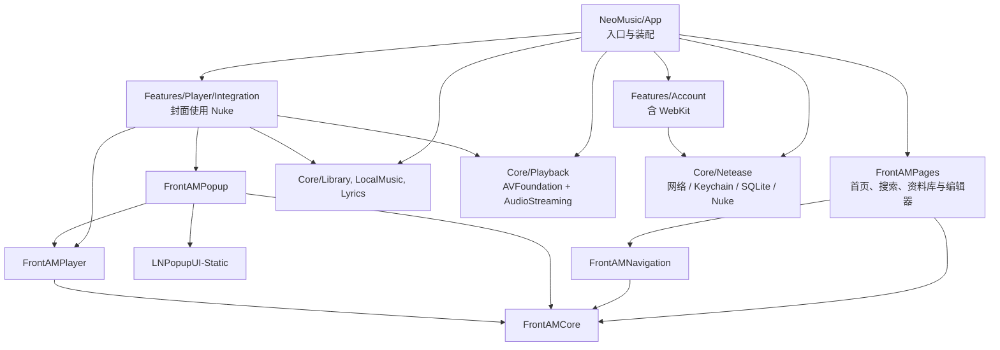

# NeoMusic 架构说明

本文档描述 NeoMusic 仓库的工程结构、模块职责、依赖边界、运行时装配关系与构建入口。

## 1. 工程与 Target 结构

工程配置源为根目录 `project.yml`，通过 XcodeGen 生成 `NeoMusic.xcodeproj`。

- 平台与语言：iOS 27.0+，Swift 6.0，iPhone（`TARGETED_DEVICE_FAMILY: "1"`）
- 主应用 Bundle ID：`com.elsterlee.NeoMusic`
- 后台模式：`UIBackgroundModes: [audio]`；开启 `UIFileSharingEnabled` 与 `LSSupportsOpeningDocumentsInPlace`

### Targets

| Target | 类型 | 源码路径 | 依赖 |
| --- | --- | --- | --- |
| `NeoMusic` | Application | `NeoMusic/` | `FrontAMCore`、`FrontAMPlayer`、`FrontAMPopup`、`FrontAMNavigation`、`FrontAMPages`、`AudioStreaming`、`AudioTags` (`AudioTagBridge`)、`Nuke`、`NukeUI` |
| `FullScreenPlayerTests` | Unit Test | `FullScreenPlayerTests/`、`Packages/FrontAM/Tests/FrontAMPlayerTests/` | `FrontAMPlayer` |
| `NeoMusicTests` | Hosted Unit Test | `NeoMusicTests/` | `NeoMusic`、`FrontAMPlayer` |
| `NeoMusicNavigationUITests` | UI Test | `NeoMusicNavigationUITests/` | `NeoMusic` |
| `NeoMusicFunctionalParityTests` | UI Test | `NeoMusicFunctionalParityTests/` | `NeoMusic` |

### Schemes

| Scheme | 构建目标 | 测试目标 |
| --- | --- | --- |
| `NeoMusic` | `NeoMusic` | `NeoMusicTests`、`FullScreenPlayerTests`、`NeoMusicNavigationUITests` |
| `NeoMusicFunctionalParity` | `NeoMusic` | `NeoMusicFunctionalParityTests` |

### 依赖包

| 依赖 | 来源 / 版本 | 路径 |
| --- | --- | --- |
| `FrontAM` | 本地包，Swift tools 6.2、Swift 6 语言模式、iOS 27.0+ | `Packages/FrontAM` |
| `AudioStreaming` | 本地包 | `Packages/AudioStreaming` |
| `AudioTags`（TagLib 封装） | 本地包 | `Packages/AudioTags` |
| `LNPopupUI` | FrontAM 本地依赖（`LNPopupUI-Static`） | `Packages/FrontAM/Vendor/LNPopupUI` |
| `LNPopupController` | LNPopupUI 本地依赖 | `Packages/FrontAM/Vendor/LNPopupController` |
| `Nuke` | SPM `13.2.0` | 远程包 |
| `LNSwiftUIUtils` | SPM `1.1.5` | 远程包 |
| `LNSystemMarqueeLabel` | SPM `0.1.2` | 远程包 |

---

## 2. 目录与模块职责

```text
NeoMusic/
├── App/                              # 入口、运行时容器、壳层导航与各领域装配
├── Core/
│   ├── Library/                      # 本地资料库、歌单/文件夹持久化、身份标识、封面缓存
│   ├── LocalMusic/                   # 本地目录扫描、音频元数据读取、下载文件标签写入
│   ├── Lyrics/                       # 歌词模型与解析读取
│   ├── Playback/                     # 播放引擎、音频图、频谱分析、队列与媒体会话
│   ├── Netease/                      # 网易云网络、凭据、账号、缓存、搜索与下载存储
│   └── PerformanceDiagnostics.swift  # AppLogger 与 os.signpost 性能打点
├── Features/
│   ├── Home/                         # 主页评审 Preview
│   ├── Library/                      # 资料库评审 Preview 与宿主扩展
│   ├── Search/                       # 搜索评审 Preview
│   ├── Account/                      # 账户页面、音质设置与 WebKit 登录页
│   └── Player/
│       ├── Integration/              # 宿主适配层（注入播放器模型、歌词、封面和页面插槽）
│       ├── NowPlayingModel.swift     # 宿主播放状态与队列模型
│       ├── NowPlayingHistory.swift   # 播放历史与账号过滤
│       ├── NowPlayingContinuation.swift # 推荐续播与队列衔接
│       └── PlaybackQueuePersistence.swift
└── Resources/                        # App 图标、资产与来源声明

Packages/FrontAM/Sources/
├── FrontAMCore/                       # 封面读取、取色、视觉组件与曲目播放状态接口
├── FrontAMPlayer/                     # 全屏播放器、Metal 着色器与来源声明
├── FrontAMPopup/                      # 迷你播放器与共享封面转场
├── FrontAMNavigation/                 # 原生 Tab、独立导航栈、Chrome 与 Zoom
├── FrontAMPages/                      # 首页、搜索、资料库与原生曲目列表
└── FrontAM/                           # 统一导出五个模块
```

---

## 3. 模块依赖边界

`scripts/check-module-boundaries.py` 静态扫描 `NeoMusic/` 和 `Packages/FrontAM/Sources/` 下的 Swift、C 系列和 Metal 源码。



核心隔离规则如下：

1. **网易云业务隔离**
   - `Netease*` 类型仅允许出现在 `Core/Netease`、`Features/Account` 与 `App`。
   - `URLSession`、`HTTPCookieStorage`、`SecItem*`、`CommonCrypto` 仅允许出现在 `Core/Netease`。
   - `URLRequest`、`HTTPCookie`、`WKWebView`、`WKWebsiteDataStore`、`WebPage`、`music.163.com`、`netease.session` 仅允许出现在 `Core/Netease` 与 `Features/Account`。
   - `Core/Netease` 不得引用 `LocalLibrary*`、`LocalMusic*`、`PlaylistLibrary`、`NowPlayingModel`、`ReferencePlayer*`、`PlayerState`、`PlayerPlaybackSource`、`PlayerServices`。
2. **`FrontAM` 包隔离**
   - 浏览线由 `FrontAMCore`、`FrontAMNavigation`、`FrontAMPages` 构成，仅使用 Apple 系统框架。`FrontAMNavigation` 依赖 `FrontAMCore`，`FrontAMPages` 依赖两者。播放线由 `FrontAMPlayer` 与 `FrontAMPopup` 构成，共用 `FrontAMCore`。`FrontAMPopup` 依赖 `FrontAMPlayer` 和 `LNPopupUI-Static`。伞形模块导出五个模块。
   - FrontAM 源码禁止引用宿主实现类型（`NowPlayingModel`、`PlaylistLibrary`、`LibraryDownloads`、`Netease*`、`LocalLibrary*`、`ArtworkImagePipeline` 等）、`Bundle.main`、`UIImage(named:)` 或账号格式前缀。
   - `.metal` 着色器限于 `FrontAMPlayer` 和宿主的 `Features/Player`。
3. **定向第三方框架导入**
   - 包源码中只有 `FrontAMPopup` 可导入 `LNPopupUI`。宿主的 `Features/Player` 可导入 `Nuke`、`NukeUI`、`MetalKit`。`NeteaseArtworkCache.swift` 可导入 `Nuke`。
   - `AudioStreaming` 仅允许在 `Core/Playback/StreamingPlaybackDeck.swift` 导入。
   - `AudioTagBridge` 仅允许在 `Core/LocalMusic/DownloadedAudioTags.swift` 导入。
   - `SQLite3` 仅允许在 `Core/Netease/NeteasePageCache.swift` 导入；`Network` 仅允许在 `Core/Netease/NeteaseMusicStore.swift` 导入；`ImageIO` 额外允许在 `Core/Netease/NeteaseAvatarSnapshot.swift` 导入。

---

## 4. 运行时装配与生命周期

### 启动与装配（`NeoMusic/App`）

- `NeoMusicApp`（`@main`）持有 `DownloadBackgroundDelegate`（UIKit 后台下载代理）与单一 `AppRuntime` 实例。
- `AppRuntime` 构造并持有：
  - `NeteaseAccount`（注入 `NeteaseAccountClient`、`NeteaseCredentialStore`、`NeteaseAvatarClient`）
  - `OnlineLibraryIntegration`、`HomeMusicIntegration`、`ArtistMusicIntegration`、`SearchMusicIntegration`、`DownloadMusicIntegration`
- 视图树通过 `LocalLibrary.app` 挂载，并经 SwiftUI `Environment` 向下注入 `account`、`libraryDownloads`、`homeMusicIntegration`、`artistMusicIntegration`、`searchMusicIntegration` 及 `artworkLoadAction`。
- `AppShell`、`LibraryAppTabs` 与 `LibraryDetailNavigation` 为 `FrontAMNavigation` 提供标签配置、各页内容、路由、预览和业务环境。

### 启动阶段并发流（`AppRuntime.start()`）

1. 绑定各 Integration 回调（`downloads.connect()`、`search.connect()`、`home.connect()`、`artists.connect()`、`onlineLibrary.connect()`、`onlineLibrary.connectLyrics()`）。
2. 并行恢复本地资料库与在线缓存。在线分支依次恢复下载索引和账号资料库页面。两条分支结束后等待在线资料库与下载元数据发布。
3. 对前六个置顶和前六个最近添加的磁盘封面并发准备缩略图，最多等待 275 ms。资料库保留导航框架，就绪时一次填入列表。
4. 迷你播放器在等待队列与身份恢复时显示“未在播放”，恢复后更新同一条播放器栏。账号身份暂不可用时，资料库首现后仍可使用本地或已下载的当前曲目。
5. 首现后并行扫描本地目录、恢复剩余在线内容。下载续传与账号校验在这一阶段执行。

### 前后台切换（`AppRuntime.sceneDidChange`）

- 进入后台：持久化播放队列（`LocalLibrary.player.saveQueueForBackground()`）与歌单状态（`LocalLibrary.playlistLibrary.saveForBackground()`）。
- 返回前台：触发本地目录刷新（`LocalLibrary.runtime.refresh()`）与账号重验（`account.revalidate()`）。

### 封面路由（`AppRuntime.requestArtwork(for:)`）

按 `DeferredArtworkKey` 的 `domain`（`.music` / `.libraryPlaylist`、`.home` / `.homePlaylist`、`.artists`、`.search`）分发到对应 Integration 请求或查询缓存文件。\`DeferredArtworkRoute\` 校验会话和缓存返回结果，Online 与 Home 共用 16 ms 封面发布合批器。五个 Integration 共用引用曲目查找、喜爱反馈或曲目投影中的相应组件。

首页来源的播放队列封面由当前与下一曲、可见队列项及 UIKit 预取回调触发。`NeteaseHomeStore` 按会话管理请求，`NeteaseArtworkCache` 将前台需求提交为高优先级，并在写入新下载前验证图像可解码。

---

## 5. 核心子系统

### 本地资料库与扫描（`Core/Library`、`Core/LocalMusic`）

- `LocalLibrary` 与 `LocalLibraryRuntime` 管理本地曲目索引、专辑聚合、最近添加（`LibraryRecentAdditions`）、播放集合历史与歌单及文件夹（`PlaylistLibrary`）。
- `LocalMusicScanner` 扫描应用 Documents 下的音乐目录；`LocalAudioMetadataReader` 读取音频元数据与封面；`LocalArtworkImages` 负责首屏封面预热并接入 Core 的内存缓存，`AlbumArtworkBackdropPreparer` 管理磁盘派生缓存；`DownloadedAudioTags` 通过 `AudioTagBridge`（TagLib）为下载音频写入标签。
- 资料库艺人由本机曲目、当前账号的喜爱歌曲与已载入的歌单曲目、收藏专辑及艺人订阅投影。`LibraryArtistPreferences` 保存本地艺人的 UUID、离线喜爱和按账号区分的艺人置顶，在线喜爱沿用账号的艺人订阅。`PinnedOrderStore` 保存艺人、专辑与播放列表的混合顺序。
- `LibraryRoute.libraryArtist` 打开资料库艺人详情，`LibraryRoute.artist` 打开在线艺人主页。已下载专辑可以从资料库艺人详情进入基于本机曲目的专辑页。本地专辑沿用目录分组和文件中的年份标签。
- 资料库艺人头像由列表、详情和置顶卡片按需读取。`NeteaseArtistStore` 按账号缓存头像元数据，复用订阅、艺人详情和图片缓存，并限制同时进行的资料库头像请求数。头像文件就绪后通过 Observation 更新对应视图。
- `AppStoragePaths` 声明音乐目录、应用状态与缓存路径。`AtomicJSONStore` 统一原子 JSON 读写，`AppDefaultsKey` 集中管理偏好键。封面取色共用 `Caches/ArtworkBackdrops.json`。
- `ImageSourceThumbnail` 负责封面、头像与选图的 ImageIO 缩略图解码。普通缩略图加载与详情页的背景取色分别触发。
- 全部歌曲、专辑、歌单与喜爱歌曲共用 `NativePlaylistTrackList`。按名称或艺人排序的全部歌曲使用 UIKit diffable data source 提供 Section 和原生索引。专辑与歌单的列表使用 `GenericCollectionList`，其网格与资料库艺人专辑共用 `LibraryCollectionGrid`。
- 歌单移到文件夹时，由 `LibraryToastCenter` 显示可打开目标文件夹的提示。

### 播放与音频管线（`Core/Playback`、`Features/Player`）

- `NowPlayingModel` 持有队列与播放状态，`PlaybackQueuePersistence` 负责队列持久化。播放队列与歌单各自通过 `BackgroundTaskPersistenceQueue` 串行写入，进入后台时使用 UIKit 后台任务完成待保存工作。
- 宿主通过适配层为迷你播放器和全屏播放器提供本地封面。专辑详情与全屏播放器共用 `FrontAMCore.ArtworkColorSpace`，各自计算所需的调色板。
- `LocalPlaybackEngine` 协调音频播放，`PlaybackAudioActor` 与 `SharedAudioGraph` 管理音频图：
  - 本地文件由 `LocalFilePlaybackNode` 解码输出。
  - 在线音频流由 `StreamingPlaybackDeck`（基于 `AudioStreaming`）解码输出。
  - 实时频谱由 Objective-C 模块 `AudioSpectrumAnalyzer` 计算。
- `PlaybackMediaSession` 对接系统媒体会话与锁屏/控制中心命令。
- `Core/Lyrics`（`LyricsReader`、`LyricsDocument`、`LyricsPresentationModel`）负责本地与在线歌词的读取、解析与呈现模型。

### 网易云业务（`Core/Netease`）

- **账户与凭据**：`NeteaseAccount` 协调登录、恢复、重验与退出；`NeteaseCredentialStore` 读写 Keychain；`NeteaseAvatarClient` 与 `NeteaseAvatarSnapshot` 管理头像缓存与本地缩略快照。
- **在线数据与缓存**：`NeteaseMusicClient` / `NeteaseMusicStore`、`NeteaseHomeStore`、`NeteaseArtistClient` / `NeteaseArtistStore`、`NeteaseSearchClient` / `NeteaseSearchStore` 负责对应领域请求与状态；`NeteasePageCache` 使用 SQLite 按账号与键持久化页面缓存；`NeteaseArtworkCache` 通过 Nuke 管理在线封面缓存。
- 五个在线 Store 共用 \`NeteaseSessionScope\` 管理会话版本和任务取消。Music、Home、Artist 共用 \`KeyedPageCacheWriter\`，Music、Home、Artist、Search 共用 \`ScopedArtworkLoader\`。
- 首页页面缓存位于 `Caches/NeteaseHome/content.sqlite`。已保存的日推快照按账号保存在 `Application Support/NeteaseHome/DailyHistory`，供历史播放引用。
- **下载**：`NeteaseDownloadStore`、`NeteaseDownloadClient`、`NeteaseDownloadTransport` 与 `NeteaseDownloadedAudio` 管理后台下载任务、NCM 解码与本地落地文件。

---

## 6. 全屏播放器模块（`FrontAMPlayer`）

`FrontAMPlayer` 的入口视图为：

```swift
FullScreenPlayerView(
    player: PlayerState,
    services: PlayerServices,
    initialPage: NowPlayingPage = .artwork,
    isActive: Bool = true,
    onDismiss: (() -> Void)? = nil,
    artworkTransition: ArtworkTransition // 默认为 EmptyModifier
)
```

全屏播放器的队列页使用同一个 UICollectionView 展示历史记录、当前歌曲和继续播放。列表默认定位到当前歌曲，历史标题与包含播放模式按钮的继续播放区头由 UIKit 吸顶。

从继续播放下拉时，长历史的展开阈值为 160 pt，短历史的阈值为完整展开所需的距离。从历史上推时，返回阈值为距历史停靠位置 160 pt，或两处停靠位置之间的距离，取较短者。两个方向都在拖动中首次达到阈值时触发一次柔和触感。松手位置与 UIKit 的同向预测落点都可触发吸附。从历史返回的手势最远停在继续播放默认位置，接续浏览待播需要再滑一次。

从待播列表向上返回时，惯性最远停在继续播放默认位置。到达该位置后，可以另起一次下拉展开历史。上下两个方向都可通过 `scrollViewWillEndDragging` 将 UIKit 的惯性目标设为停靠点，延续松手速度。下拉从继续播放默认位置开始、速度达到 1 pt/ms 且吸附目标为历史停靠点时使用此机制。上推从历史区开始、速度达到 1 pt/ms、松手位置仍在继续播放停靠点之前且吸附目标为该停靠点时也使用此机制。UIKit 未进入减速时，以及短拉回正、常速进出历史和歌曲标题收放时，通过 `setContentOffset(_:animated:)` 快速吸附。历史内部与待播列表的自由滚动使用 UIKit 惯性。队列两侧留白始终可发起播放器的下拉关闭手势。

封面页、歌词页和跨播放器页面切换使用共享封面视图。队列页停留期间，当前歌曲封面由歌曲标题单元格承载，随列表滚动并在列表边缘裁切、淡出。与队列切页时，仅在当前歌曲封面与列表视口相交时衔接其几何位置；封面完全离屏时，共享封面保持目标尺寸，随歌名、艺人一起向下推入或向上推出。封面渐隐区从屏幕顶端延伸至封面落位的上沿，拉手在封面前方。快速反向点按沿用当前转场的封面路径。队列与歌词页之间的离屏封面仍在原位淡出或淡入。切页保留队列的浏览位置。历史记录的「清除」按钮打开系统确认弹窗。确认后立即清除当前播放历史并回到继续播放默认位置。

在历史记录点播歌曲时，列表通过 UIKit 滚动动画回到继续播放默认位置。浏览历史时发生被动切歌，列表保留历史位置，在最新记录一端随新行上移。

宿主通过以下公开类型接入全屏播放器：

| 类型 | 职责 |
| --- | --- |
| `PlayerPlaybackSource` / `PlayerState` | 以 Observation 暴露当前曲目、时间轴锚点（`PlayerTimelineAnchor`）、播放状态、队列条目（`PlayerQueueEntry`）与控制动作 |
| `PlayerActions` | 提供喜爱、收藏/歌单、专辑/艺人导航、音质/设置入口与提示回调（`PlayerNotice`） |
| `PlayerLyricsSource` | 按 `trackID` 加载 `PlayerLyrics`，可选支持歌词文件导入 |
| `PlayerArtworkProvider` | 按 `PlayerArtworkRequest` 分别提供满足目标尺寸的缓存查询与即时显示用的备用位图，并支持异步加载和可取消的队列封面预取 |
| `PlayerServices` | 聚合 `actions`、`lyrics`、`artwork` 与可选 `diagnostics`（`PlayerDiagnostics`） |

宿主在 `Features/Player/Integration/` 中通过 `ReferenceNowPlayingView`、`NeoMusicPlayerServices`、`ReferencePlayerState`、`ReferencePlayerActions`、`ArtworkImagePipeline`、`PlayerPopup` 将上述接口连接到 `NowPlayingModel`、`LyricsReader` 和宿主封面管线。

Xcode 将 `NowPlayingStitchableShaders.metal` 编译为包资源 bundle 中的 `default.metallib`。模块通过 `ShaderLibrary.bundle(Bundle.module)` 使用着色器。播放器的 GPL-3.0 文本及来源清单随同 bundle 打包，FrontAM 原创部分采用 MIT 许可。

`NeoMusic` scheme 保留独立的 `FullScreenPlayerTests` 测试 target。资源用例从播放器的实际 bundle 检查 `default.metallib` 和来源声明，并在运行环境提供 Metal 设备时加载库、检查两个着色器入口。播放器契约与音量惯性测试源同时用于 Xcode 和 SwiftPM。包内另有 Core、Navigation 和 Pages 测试。NeoMusic scheme 的测试动作指定 `zh-Hans`。
### 迷你播放器模块（`FrontAMPopup`）

`FrontAMPlayerPopup` 从 SwiftUI 环境读取 `PlayerState`。调用者传入展开状态 binding、可选的暂时隐藏曲目状态、迷你栏配色和关闭回调，并通过 `PlayerArtworkProvider` 提供同步缓存、即时备用位图、异步读取和预取。缺失封面及展开内容由 ViewBuilder 接入，展开内容收到当前活动状态与关闭动作。活动状态回调可用于诊断日志。

NeoMusic 的 `PlayerPopup` 适配层保留资料库播放指示器，并注入原有封面占位、预取路由、全屏播放器、Toast 与日志。迷你栏与全屏的封面通过同一套宿主图片管线处理，尺寸策略分别保留。

`FrontAMPopup` 负责「未在播放」占位、播放控制、VoiceOver 元数据和原有 UIKit 手势协调。标题横滑使用展开、点按和高亮手势的角色。包内的 `FrontAMPopupArtworkTransition` 为全屏封面接入共享转场。

`NeoMusic` 直接链接 `FrontAMPopup`，由它单独引入 LNPopup 静态依赖。`NeoMusicTests` 通过 `BUNDLE_LOADER` 从宿主解析这条依赖链的符号。

迷你播放器展开或收起时，LNPopupUI 只在全屏端有已布局且可见的当前歌曲封面时匹配封面位置。队列封面滚出视口时，面板使用 LN 原有的无封面匹配转场。

### 导航与 Tab 壳层（`FrontAMNavigation`）

- `FrontAMTabs` 将宿主提供的 `FrontAMTabItem` 交给 `UITabBarController`。搜索使用固定的 `UISearchTab`。标签排序沿用原生列表编辑，应用顺序由 `FrontAMTabOrder` 计算，`FrontAMTabStorage` 接收可配置的 `UserDefaults` 键。NeoMusic 沿用 `appTabOrder.v1` 与 `appTabHidden.v1`。
- `FrontAMTabNavigations` 按标签保存各自的 `FrontAMNavigationStack`。栈使用 `UINavigationController` 执行 push、pop 及交互式 Zoom。`FrontAMNavigationChrome` 管理导航标题、搜索控制器和当前页面配色，标签栏与迷你播放器读取所选栈的配色。
- `FrontAMNavigationContainer` 可独立承载一条栈。宿主按路由提供页面、预览、标题初值、Zoom 源或对齐区域，以及通过 `FrontAMSearchPresentation` 提供的搜索状态与动作。账号匹配、封面预览和各页的业务环境由宿主提供。
- `FrontAMShell` 提供播放器路由与关闭回调。播放器发起路由时立即更新当前导航栈，然后关闭弹层，关闭期间的相同请求合并。账户和音质设置、清除队列确认与 Toast 由 NeoMusic 的 `AppShell` 装配。

### 页面与视觉模块（`FrontAMPages`、`FrontAMCore`）

- FrontAM 的五个模块各有 SwiftPM 本地化资源，支持简体中文和英语。宿主提供名称、目录数据及搜索自定义提示。播放模块的上游界面保留原文案。
- `CollectionMenuActions.showsPlaylistEditingActions` 由宿主提供歌单编辑入口的能力，资料库页面将歌单 ID 作为不透明标识。
- `SearchPageModel` 和 `HomeContentModel` 接收宿主提供的展示数据与动作。搜索结果、Feed、资料库、详情、歌单和歌曲选择器由 `FrontAMPages` 渲染。宿主继续构建在线与本地数据投影，并经环境提供工具栏账户按钮、导航动作和 Toast 目标。
- `FrontAMPlaylistSource` 提供歌单快照、编辑命令与分页回调，`FrontAMDownloadSource` 提供下载状态与操作。宿主的 `PlaylistLibrary`、`LibraryDownloads` 实现这些接口并持有数据、会话和任务。曲目行通过 SwiftUI 环境读取 `FrontAMTrackPlayback`，播控动作仍由宿主提供。
- `FrontAMArtworkProvider` 提供同步封面查询、异步解码及取色。`FrontAMLocalArtworkProvider` 采用 `NSCache` 和 ImageIO 读取本地文件，宿主用 `ArtworkLoadAction` 注入延迟封面和头像的解析并接入磁盘取色缓存。Core 持有设计令牌、封面与背景、菜单、Toast 和 Sheet 通用组件。

---

## 7. 构建与检查命令

生成工程与检查模块边界：

```sh
python3 scripts/check-module-boundaries.py
xcodegen generate
```

脚本回归测试：

```sh
PYTHONDONTWRITEBYTECODE=1 python3 -m unittest discover -s scripts/tests
```

模拟器 Release 构建：

```sh
xcodebuild -project NeoMusic.xcodeproj -scheme NeoMusic -configuration Release \
  -sdk iphonesimulator -destination 'generic/platform=iOS Simulator' \
  -derivedDataPath DerivedData CODE_SIGNING_ALLOWED=NO build
```

定向单元测试（将 `<UDID>` 替换为本机 iOS 27.0 iPhone 模拟器 ID）：

```sh
xcodebuild -project NeoMusic.xcodeproj -scheme NeoMusic -configuration Release \
  -destination 'platform=iOS Simulator,id=<UDID>' \
  -derivedDataPath DerivedData CODE_SIGNING_ALLOWED=NO ENABLE_TESTABILITY=YES \
  -only-testing:NeoMusicTests -only-testing:FullScreenPlayerTests test
```

本机全量检查与未签名打包脚本：

```sh
bash scripts/ci.sh
bash scripts/release.sh
```
